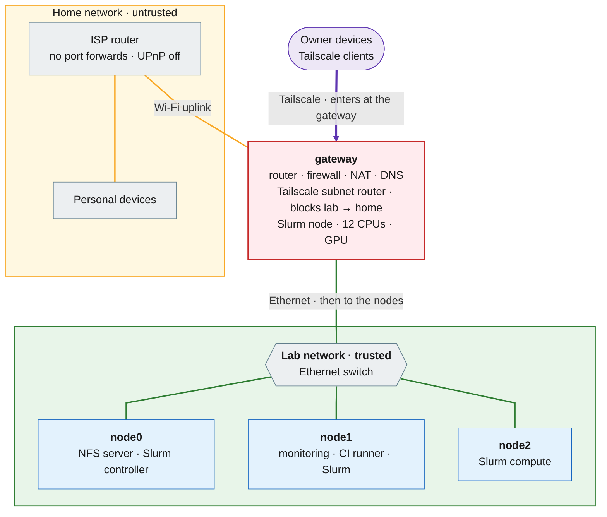
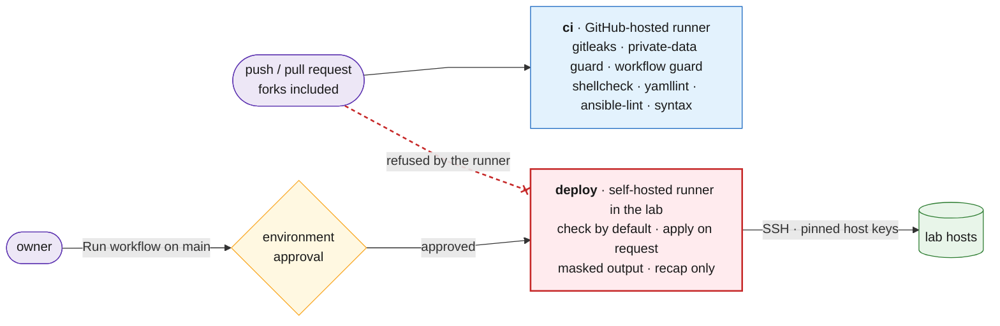

# homelab-infra

[](https://github.com/RyanMoore-phys/homelab-infra/actions/workflows/ci.yml)


Infrastructure as code for a four-machine Ubuntu homelab: a Linux gateway
that routes and segments a private lab network, a four-node Slurm cluster
(the three lab nodes plus the gateway's CPUs and GPU)
with shared NFS storage, and a monitoring stack, with **zero ports exposed to
the internet**. Every host setting is an idempotent Ansible role, checked by
CI on every push and deployed through a gated, owner-approved pipeline.

This repository is public, so it is built to hold **no addresses, keys,
logins or tailnet names**. CI fails the build if one appears, and the guards
that enforce this are themselves tested with planted leaks.

---

## Architecture



<sub>Colors used in every diagram: **red** security boundary · **purple** tailnet · **green** trusted lab · **amber** untrusted home network · **blue** hosts. See [diagram conventions](docs/architecture.md#diagram-conventions).</sub>

| Machine | Role |
|---|---|
| **gateway** | A dedicated machine between the home network and the lab: routing, NAT, dnsmasq, default-deny firewall, lab→home block, the Tailscale subnet router every remote session goes through, HTTPS for lab web UIs, and a Slurm compute node with 12 CPUs and the lab's only GPU ([ADR-0007](docs/decisions/0007-gateway-joins-slurm.md)) |
| **node0** | NFS v4.2 server for shared simulation data, Slurm controller, compute |
| **node1** | Grafana + Prometheus (Docker Compose), Slurm job board, self-hosted Actions runner, compute |
| **node2** | Compute |

Every machine runs Tailscale, but remote traffic is directed **through the gateway first**: SSH, Ansible, monitoring and the web UIs all reach the nodes by their lab address over its subnet route. Each node's own tailnet address is kept only as a fallback for when the gateway is down.

Deeper: [architecture](docs/architecture.md) · [network, packet path and port matrix](docs/network.md) ·
[access model](docs/security/access-model.md) · [CI/CD](docs/cicd.md)

## Security model

| Layer | Control | Verified by |
|---|---|---|
| Ingress | No port forwards, UPnP off. Tailscale is the only way in; remote traffic goes through the gateway first, with each node's own tailnet address as a fallback ([ADR-0002](docs/decisions/0002-tailscale-only-ingress.md)) | every node sees the owner's sessions arrive from the gateway's lab address; router settings checked by hand |
| SSH | Keys only, no passwords or keyboard-interactive, no X11, root by key only, `MaxAuthTries 3` | password login refused on all hosts |
| Credentials | Every automation key pinned with `from=` to the one machine that uses it; the owner key has a passphrase | same key from an unlisted source refused |
| Segmentation | Lab reaches the internet but cannot open connections to the home network | node → home router refused; internet and DNS still work |
| Services | Prometheus on `127.0.0.1`; Grafana and the wiki on node1's lab address, published on the tailnet by the gateway over HTTPS | Prometheus refused from the network; Grafana healthy through the gateway |
| Storage | NFS exports list each client (three, including the gateway), `root_squash` | exports reviewed; role refuses wildcard exports |
| Patching | Unattended upgrades everywhere, including Tailscale and Docker CE; nodes reboot through Slurm after their running jobs when an update needs it; Dependabot for actions, tools and monitoring images ([patching](docs/patching.md), [ADR-0008](docs/decisions/0008-unattended-patching-and-drained-reboots.md)) | `make patch-status`; reboot script tested on every Slurm state |
| Supply chain | Actions pinned to commit SHAs; Python, Ansible, linters, collections pinned; Dependabot | CI |
| Public repo | Private-data guard, gitleaks on full history, workflow guard, masked deploy logs | guards tested with planted leaks |

What it protects against, and what it knowingly accepts: [threat model](docs/security/threat-model.md).

## Engineering notes

Problems found during the hardening, and what they taught:

1. **Docker publishes around the firewall.** Grafana and an unauthenticated
   Prometheus were reachable from the whole network although ufw denied the
   ports: Docker's iptables chains run before ufw's. Prometheus now binds to
   localhost; web UIs are published by the gateway with `tailscale serve`.
   ([ADR-0003](docs/decisions/0003-explicit-binds-and-gateway-published-uis.md))
2. **So does Tailscale.** Per-port ufw denies on `tailscale0` did nothing:
   `tailscaled` jumps to its own `ts-input`/`ts-forward` chains first. Reading
   the gateway's real chains also showed `ts-forward` accepts lab → tailnet
   traffic, which only Tailscale ACLs can close (on the roadmap).
   ([packet path](docs/network.md#packet-path-through-the-gateway))
3. **Gateway first, with a fallback.** Everything that used the nodes'
   tailnet addresses (Prometheus scrapes, published UIs, SSH, Ansible) was
   moved to lab addresses behind the gateway, and each node was checked to see
   sessions arrive from the gateway's address. Taking the nodes off the tailnet
   entirely was built and then rejected: their own Tailscale clients stay as a
   fallback, so the gateway is never a single point of failure for access.
   ([ADR-0002](docs/decisions/0002-tailscale-only-ingress.md))
4. **`sshd` keeps the first value it reads.** Cloud-init's
   `50-cloud-init.conf` re-enabled password login over any later drop-in; the
   hardening drop-in is named `00-` for that reason. ([access model](docs/security/access-model.md))
5. **Public Actions logs are public.** Inventory values are not secrets to
   GitHub's masker; the deploy job masks every address itself and prints only
   the recap. ([CI/CD](docs/cicd.md))
6. **The router is also a compute node, on purpose.** The gateway has most of
   the lab's CPUs and its only GPU, so it joined Slurm with 2 GB held back for
   routing and its slurmd reachable from the controller only. The cost is
   written down: two schedulers share it, and multi-node steps that span it
   must start on the controller. ([ADR-0007](docs/decisions/0007-gateway-joins-slurm.md))
7. **Encode, then prove.** Hand fixes were turned into roles, and a check-mode
   run against the live gateway reports `changed=0`: code and reality agree.

Full log: [hardening log](docs/security/hardening-log.md). Decisions and their trade-offs: [ADRs](docs/decisions/README.md).

## CI/CD



A pull request cannot run on the self-hosted runner, even one that adds its
own workflow: the runner's job-started hook refuses every job except the
owner's manual deploy from `main`, before checkout. Nothing private is stored
in GitHub; the runner's key and inventory are mounted read-only on node1
([ADR-0005](docs/decisions/0005-self-hosted-runner-on-a-public-repo.md),
[sequence diagram](docs/cicd.md)).

## Quick start

Requirements: Python 3.12+, `make`, SSH access to your hosts.

```bash
make setup                                          # pinned Ansible, linters, collections in .venv
cp inventory/hosts.example.yml inventory/hosts.yml  # your hosts (gitignored)
make test                                           # everything CI runs; no lab access needed
make check-host HOST=node2                          # dry run on one machine (asks for its sudo password)
make apply-host HOST=node2                          # apply to that machine
make patch-status                                   # read-only: reboots and updates waiting
```

The admin account has password-free sudo on every machine (CI deploys need
it), so `make check LIMIT=<host>` and `make apply LIMIT=<host>` run without a
prompt; `check-host` / `apply-host` ask for a sudo password, for a machine set
up without it. `make help` lists every target.

## Repository layout

```text
.
├── playbooks/
│   ├── site.yml                # baseline for all hosts, then router / NFS / Slurm plays
│   └── patch-status.yml        # read-only report: reboots, pending and held updates
├── roles/
│   ├── auto_updates/           # unattended upgrades (incl. Tailscale, Docker CE), drained reboots
│   ├── ssh_hardening/          # sshd drop-in, validated with `sshd -t` before install
│   ├── authorized_keys/        # keys with from= source pinning
│   ├── sudo_nopasswd/          # unattended sudo for the automation account, visudo-checked
│   ├── firewall/               # ufw defaults, tailnet, lab trust, host rules
│   ├── router/                 # forwarding, NAT, lab→home block, dnsmasq
│   ├── nfs_server/             # per-share exports, refuses wildcard clients
│   └── slurm/                  # slurm.conf, cgroup.conf, gres.conf (GPU) from inventory
├── inventory/hosts.example.yml # shape of the private inventory (RFC 5737 addresses)
├── group_vars/all.yml          # shared defaults, nothing identifying
├── scripts/                    # check-private-data.sh, check-workflows.sh
├── runner/                     # self-hosted runner: compose file, job-started hook, start script
├── docs/
│   ├── architecture.md · network.md · cicd.md · patching.md · verification.md
│   ├── security/               # threat model, access model, hardening log
│   ├── decisions/              # ADR-0001 … 0008
│   └── runbooks/               # runner, router failover, Slurm, gateway in Slurm, job board, rollback
├── .github/workflows/          # ci.yml (hosted) · deploy.yml (self-hosted, gated)
└── Makefile                    # setup · test · check(-host) · apply(-host) · patch-status
```

## Verification

Each control has a test that fails if the control breaks, usually run from
both sides: the path that must work and the path that must be refused.
Commands and results: [verification](docs/verification.md).

## Roadmap

- [ ] Molecule scenarios to converge each role in a container in CI
- [ ] Tailscale ACLs as code (`policy.hujson` + GitOps action): limit the subnet route to SSH and HTTPS, and stop lab → tailnet traffic
- [ ] VLANs on a managed switch: separate trust zones for compute and services
- [ ] Alerting (Alertmanager) for disk, NFS and Slurm node state
- [ ] Encrypted off-host backups of node state

## License

[MIT](LICENSE)
