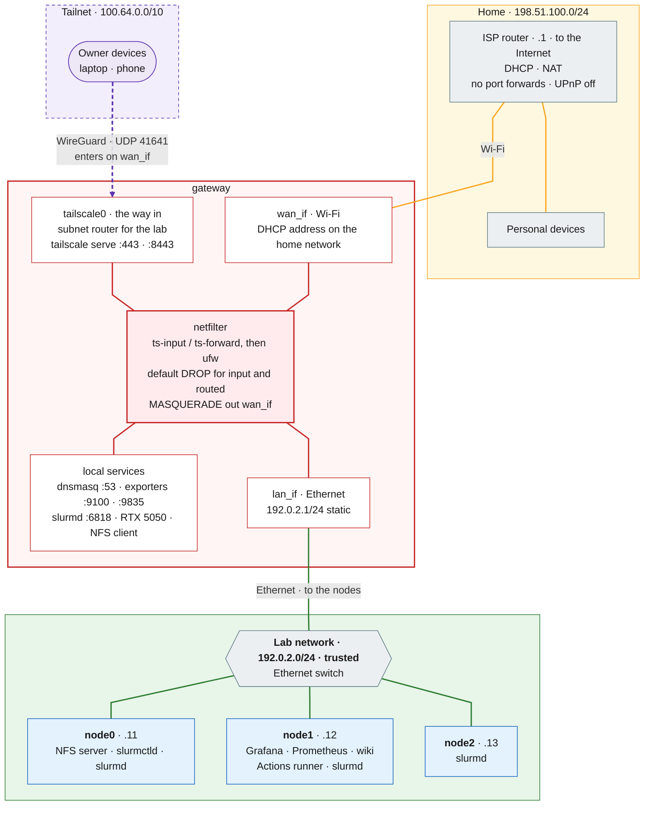
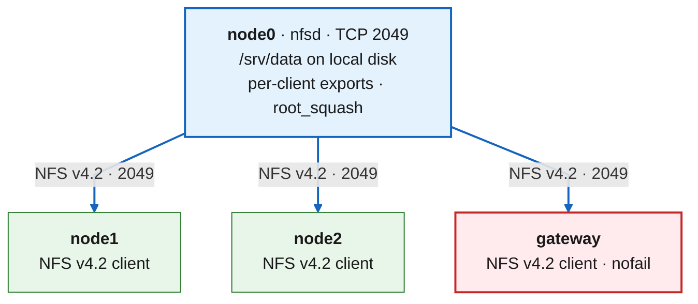
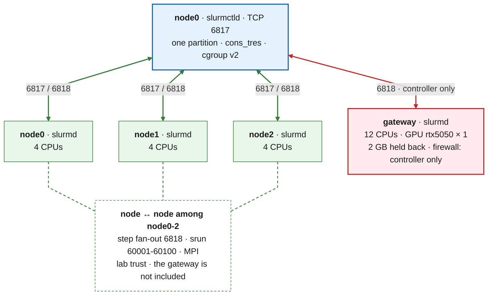
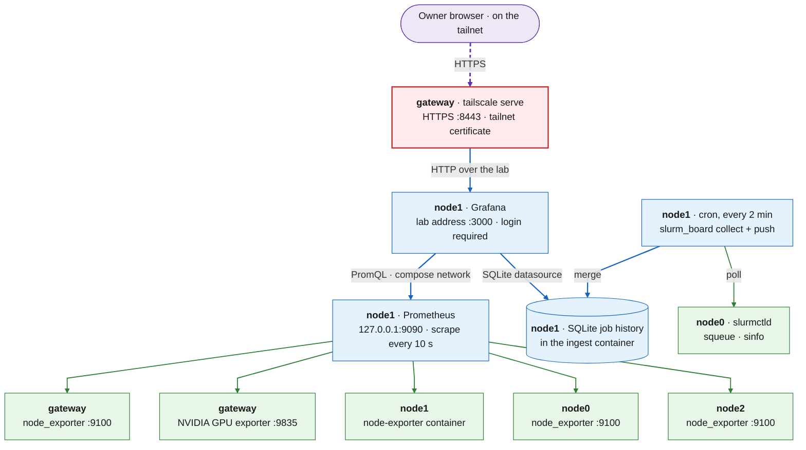

# Architecture

> Addresses are from the RFC 5737 documentation ranges. The real addressing
> plan lives only in the private inventory.

## Diagram conventions

| Color | Meaning |
|---|---|
| 🟥 red, thick border | security boundary (the gateway, anything that decides what passes) |
| 🟪 purple, dashed lines | Tailscale tailnet / WireGuard overlay |
| 🟩 green | trusted lab zone and lab links; accepted packets |
| 🟨 amber | untrusted home network and its links; approval gates |
| 🟦 blue | hosts and the services on them |
| ⬜ grey | third-party or passive infrastructure (ISP router, switch) |

Solid lines are physical or logical connections; dashed red lines with ✗ are
flows that are blocked.

## 1. Topology

The gateway is a **dedicated machine** with two physical interfaces: Wi-Fi to
the home network and Ethernet to the lab switch. It is the only machine on
both networks, the path every remote session takes into the lab, and since
[ADR-0007](decisions/0007-gateway-joins-slurm.md) also a Slurm compute node.

* **Routing.** Lab nodes use static addresses with the gateway as default
  route and DNS server (dnsmasq; no DHCP in the lab). The gateway NATs the lab
  out of `wan_if`.
* **Remote access goes through the gateway first.** It advertises the lab
  subnet on the tailnet, so a tailnet device reaches a node by its lab
  address; the gateway masquerades that traffic, and nodes see every session
  arrive from `192.0.2.1`. SSH, Ansible, monitoring and the web UIs (published
  with `tailscale serve`) all use this path.
* **Fallback.** Every node also runs Tailscale. Its own tailnet address is
  used only when the gateway is down or being changed
  ([ADR-0002](decisions/0002-tailscale-only-ingress.md)), and makes the
  [router failover](runbooks/router-failover.md) possible remotely.

## 2. Host roles

| Host | Inventory groups | Services | Ansible roles |
|---|---|---|---|
| gateway | `router`, `slurm_nodes` | routing, NAT, dnsmasq, Tailscale subnet router + `tailscale serve`, node and GPU exporters, slurmd with the GPU, NFS client | baseline + `router` + `slurm` |
| node0 | `lab_nodes`, `nfs_server`, `slurm_nodes` | NFS v4.2 server, slurmctld, slurmd, node_exporter, game server | baseline + `nfs_server` + `slurm` |
| node1 | `lab_nodes`, `slurm_nodes` | Grafana, Prometheus, wiki (Docker Compose), Slurm job board, Actions runner, slurmd, NFS client | baseline + `slurm` |
| node2 | `lab_nodes`, `slurm_nodes` | slurmd, node_exporter, NFS client | baseline + `slurm` |

*Baseline* = `auto_updates`, `ssh_hardening`, `authorized_keys`, `firewall`.

## 3. Compute and storage

One Slurm partition spans four machines. node1 and node2 are identical 4-CPU
compute nodes; node0 is also the storage server and the scheduler; the
gateway adds 12 CPUs and the GPU.

### Storage

### Scheduling

* `cons_tres` with CPU and memory as consumable resources, cgroup v2
  confinement and no swap: a job that outgrows its request is killed alone.
  `slurm.conf` is generated from the inventory and identical on every node,
  so adding a node is an inventory change.
* **The gateway** ([ADR-0007](decisions/0007-gateway-joins-slurm.md),
  [runbook](runbooks/add-gateway-to-slurm.md)) is uncapped apart from
  `MemSpecLimit=2048` (2 GB kept for routing) and offers its GPU as a GRES
  (`srun --gres=gpu:1`). Its firewall admits Slurm traffic **from the
  controller only**, so single-node jobs and steps launched on node0 run there,
  while a multi-node step started on node1, node2 or the gateway, or MPI
  spanning the gateway, is blocked. It also runs work outside Slurm; drain it
  before a large GPU stage.
* NFS v4.2 uses one TCP port; clients need neither rpcbind nor mountd.
  Exports name each client and always squash root.
* Long-running services are **not** Slurm jobs:
  [ADR-0006](decisions/0006-services-are-not-slurm-jobs.md).

## 4. Observability

Red: on the gateway. Blue: the monitoring stack on node1. Green: what it
reads: scrape targets (pulled every 10 s over the lab) and the Slurm
controller, polled every 2 minutes for the job board
([slurm-dashboard.md](runbooks/slurm-dashboard.md)).

Prometheus has no authentication, so it listens on localhost only; Grafana
reaches it over the Compose network. Docker-published ports bypass ufw, so
port bindings are the real access control:
[ADR-0003](decisions/0003-explicit-binds-and-gateway-published-uis.md).
