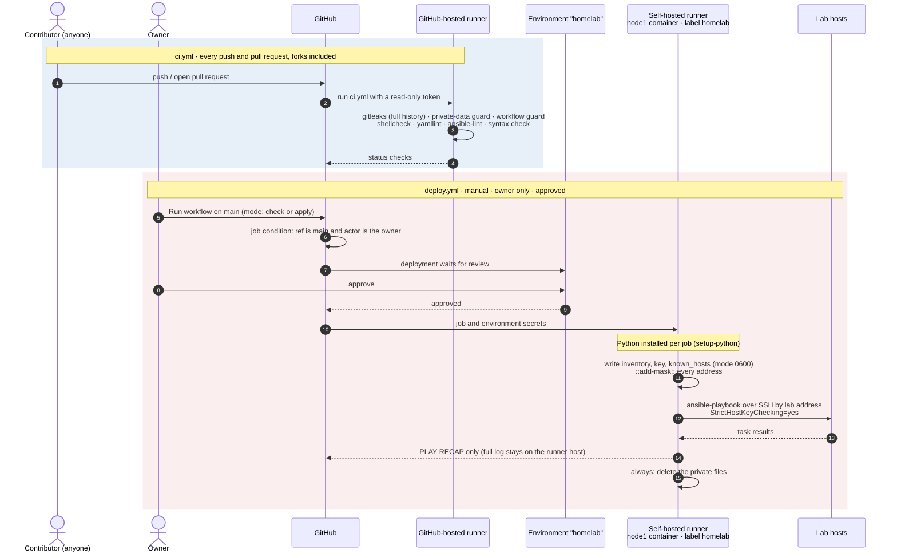

# CI/CD

## Pipeline

## Why a public repository can safely have a self-hosted runner here

| Risk | Control |
|---|---|
| A pull request (from a fork or not) runs code on the runner | No workflow that targets the runner has a PR trigger. `scripts/check-workflows.sh` fails CI if one ever does; tested with a planted unsafe workflow |
| Someone else starts a deploy | `workflow_dispatch` needs write access; the job also checks `actor == repository_owner` and `ref == main` |
| A deploy runs unreviewed | protected environment with a required reviewer and `main`-only deployment branch |
| Secrets in logs (Actions logs of public repos are public) | inventory and keys arrive as environment secrets; every IP and tailnet name is masked; only the recap is printed |
| Token abuse from a workflow | `permissions: contents: read`; `persist-credentials: false` on checkout |
| Compromised third-party action | actions pinned to full commit SHAs; Dependabot proposes updates |
| Tool drift | Python, Ansible, linters and collections pinned; `make setup` builds the same environment everywhere |

See [ADR-0005](decisions/0005-self-hosted-runner-on-a-public-repo.md) and the
[runner runbook](runbooks/self-hosted-runner.md).

## Status

* `ci.yml` runs from the first push.
* `deploy.yml` is ready. Its runner is staged on node1 (`~/homelab-runner`,
  label `homelab`) and registers with a one-time token; the `deploy` user and
  the `homelab` environment's secrets follow the
  [runner runbook](runbooks/self-hosted-runner.md). Until all three exist, the
  lab is managed from the owner's laptop with `make check-host` / `make apply-host`.
