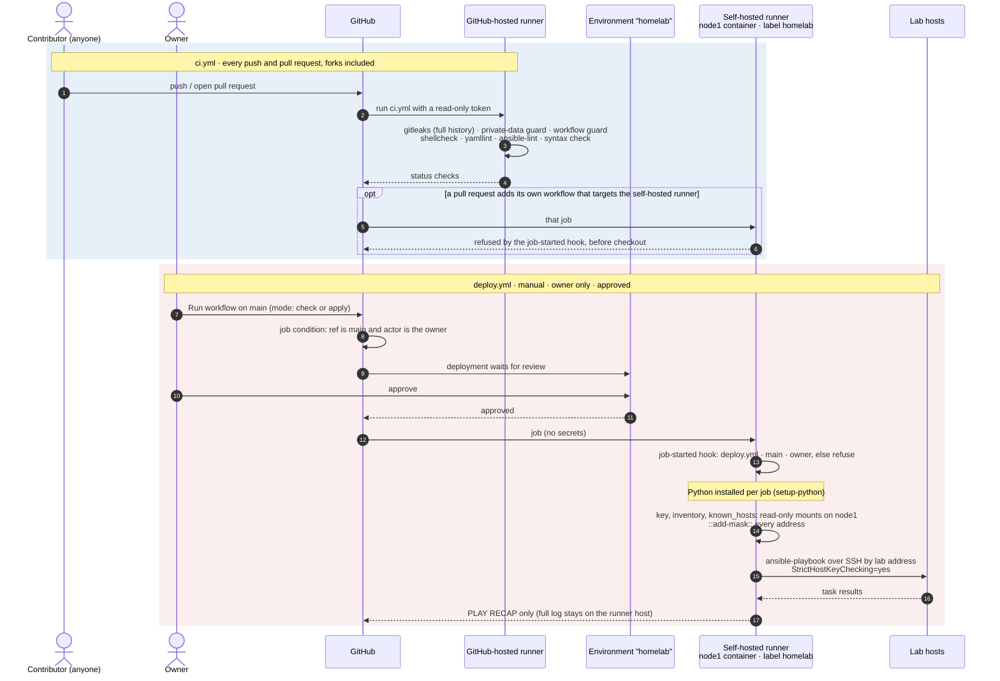

# CI/CD

## Pipeline

## Why a public repository can safely have a self-hosted runner here

| Risk | Control |
|---|---|
| A pull request (from a fork or not) runs code on the runner | GitHub runs a pull request's own workflow files, so a rule inside this repository's workflows is not enough. The runner's job-started hook ([`runner/job-started.sh`](../runner/job-started.sh)) refuses every job except `deploy.yml` on `main` started by the owner, before checkout; tested with 11 cases. Fork pull requests also wait for approval (repository setting), and `scripts/check-workflows.sh` keeps this repository's own self-hosted workflows dispatch-only (tested with a planted unsafe workflow) |
| A job rewrites the hook | mounted read-only and owned by root inside the container |
| Someone else starts a deploy | `workflow_dispatch` needs write access; the job checks `actor == repository_owner` and `ref == main`, and the hook checks the same on the runner |
| A deploy runs unreviewed | environment with a required reviewer and `main`-only deployment branch |
| Secrets in logs (Actions logs of public repos are public) | nothing private comes from GitHub: the SSH key, inventory and known_hosts are mounted read-only into the runner on node1; every IP and tailnet name is masked; only the recap is printed |
| Token abuse from a workflow | `permissions: contents: read`; `persist-credentials: false` on checkout |
| Compromised third-party action | actions pinned to full commit SHAs; Dependabot proposes updates |
| Tool drift | Python, Ansible, linters and collections pinned; `make setup` builds the same environment everywhere |

See [ADR-0005](decisions/0005-self-hosted-runner-on-a-public-repo.md) and the
[runner runbook](runbooks/self-hosted-runner.md).

## Status

* `ci.yml` runs from the first push.
* `deploy.yml` runs on the runner `homelab-node1` (node1, label `homelab`,
  files in [`runner/`](../runner)). It deploys as the owner's admin account,
  which has password-free sudo on every machine, with a key accepted only from
  node1. The job's steps were rehearsed inside the runner container in check
  mode against all four machines ([verification](verification.md)). The lab
  can still be managed from the owner's laptop with `make check-host` /
  `make apply-host`.
