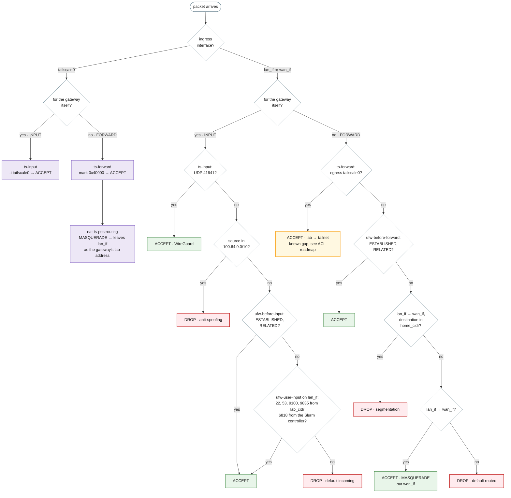

# Network

## Addressing plan

| Network | Example CIDR | Default gateway | DHCP | DNS |
|---|---|---|---|---|
| Home (upstream) | 198.51.100.0/24 | ISP router | ISP router | ISP router |
| Lab | 192.0.2.0/24 | gateway `.1` | none (static, netplan) | gateway (dnsmasq → public resolvers) |
| Tailnet | 100.64.0.0/10 (CGNAT) | n/a | Tailscale | MagicDNS |

Every machine has a tailnet address, but remote traffic goes through the
gateway first: nodes are reached by their lab address over its subnet route.
A node's own tailnet address is a fallback for when the gateway is down
([ADR-0002](decisions/0002-tailscale-only-ingress.md)).

## Routing and segmentation

| Flow | Policy | Mechanism on the gateway |
|---|---|---|
| Lab → Internet | allow | ufw route allow `lan_if → wan_if`; `MASQUERADE` out `wan_if` (`/etc/ufw/before.rules`) |
| Lab → home network | **deny** | ufw route deny to `home_cidr`, first in the routed rule list |
| Lab → home, UDP from port 41641 | allow (narrow exception) | nodes keep direct WireGuard paths to tailnet devices on the home network; ufw route allow above the deny |
| Tailnet → lab | allow | Tailscale `ts-forward` accepts, `ts-postrouting` masquerades: nodes see the gateway's lab address |
| Lab → tailnet devices | allow (**known gap**) | Tailscale `ts-forward -o tailscale0 -j ACCEPT` runs before ufw; closing it needs Tailscale ACLs |
| Home network → lab | deny | no route on the ISP router; routed default policy is DROP |
| Internet → anything | none | no port forwards, UPnP off |

## Packet path through the gateway

Drawn from the gateway's live rule set (`iptables -S`, `iptables -t nat -S`).
Tailscale's chains are jumped to **before** ufw's in both INPUT and FORWARD.

### Two things that sit in front of ufw

1. **Tailscale** jumps to `ts-input` and `ts-forward` before ufw's chains.
   Tailnet traffic is accepted there, so per-port ufw rules on `tailscale0`
   have no effect, on the gateway and on the nodes alike. Traffic that takes
   the normal path enters through the gateway and reaches a node as ordinary
   lab traffic; a node's firewall does not filter its fallback tailnet path.
2. **Docker** publishes container ports through its own chains, which bypass
   ufw entirely. The port binding (`127.0.0.1:` or a specific address) is the
   access control.

## Port matrix

Listening services reachable from somewhere other than localhost. For the
nodes, "Tailnet" is the normal path through the gateway's subnet route; the
same ports also answer on a node's own tailnet address (the fallback). Reachability
of the gateway's Slurm ports was measured from every node (TCP connect).

| Host | Port | Service | Lab | Tailnet | Home / Internet |
|---|---|---|---|---|---|
| gateway | 22/tcp | OpenSSH (keys only) | yes | yes | no |
| gateway | 41641/udp | Tailscale WireGuard | n/a | n/a | via NAT traversal only |
| gateway | 53 | dnsmasq | yes | yes | no |
| gateway | 9100, 9835/tcp | node / GPU exporters | yes | yes | no |
| gateway | 443, 8443/tcp | `tailscale serve`: wiki, Grafana (HTTPS) | no | yes | no |
| gateway | 6818/tcp | slurmd | **Slurm controller only** | no | no |
| gateway | 60001-60100/tcp | srun callbacks | not open (multi-node steps start on node0) | no | no |
| node0-2 | 22/tcp | OpenSSH (keys only) | yes | via gateway | no |
| node0-2 | 9100/tcp | node_exporter | yes | via gateway | no |
| node0-2 | 6818/tcp, 60001-60100/tcp | slurmd, srun callbacks | yes | via gateway | no |
| node0 | 2049/tcp | NFS v4.2 (named clients only) | yes | via gateway | no |
| node0 | 6817/tcp | slurmctld | yes | via gateway | no |
| node1 | 3000, 8080/tcp | Grafana, wiki (lab address) | yes | via gateway | no |
| node1 | 9090/tcp | Prometheus | **localhost only** | no | no |
