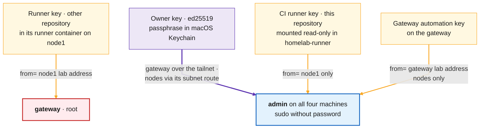

# Access model: who can log in where

Purple: the owner's key. Amber: automation keys, each pinned with `from=` to
the one lab address that uses it. Every account shown can reach root without
a password; the `from=` pins are what keep a copied automation key useless.

## Controls

| Control | Setting | Why |
|---|---|---|
| Authentication | public key only; `PasswordAuthentication no`, `KbdInteractiveAuthentication no` | nothing to brute-force |
| Root | `PermitRootLogin prohibit-password` | root only by key, for the other repository's runner (pinned to node1). Key files are exclusive: a key not in the inventory is removed. That is how an unused second root key without `from=`, found on 2026-11-23, was removed the same day |
| Unattended sudo | admin account: password-free sudo on every machine (`sudo_nopasswd` role on the nodes) | CI deploys run as it; owner's choice over a separate account |
| Source pinning | `from="<lab address>"` on every automation key. On node1 the CI key is also accepted from node1's own Docker networks, because the runner container reaches its own host from its bridge address; off node1 no TCP handshake can complete from those addresses | a copied key is useless anywhere else |
| Normal path | nodes are reached through the gateway; sessions arrive from its lab address. Each node's own tailnet address is a fallback | one place to watch, without losing access if it fails |
| Slurm | munge key on all four machines; a job runs as its submitting user wherever it lands, including the gateway | one user today; revisit before sharing |
| Attempts | `MaxAuthTries 3` | limits key enumeration per connection |
| Forwarding | `X11Forwarding no` | no reason to expose a display channel |
| Owner key | passphrase, held by the macOS Keychain | a copied key file alone is not enough |

`from=` sources were taken from 14 days of `sshd` logs before being applied,
then tested both ways: allowed sources still log in, and an unlisted source
(the same key over an IPv6 link-local address) is refused.

## Why the drop-in is called `00-hardening.conf`

`sshd` keeps the **first** value it reads for each keyword, and
`sshd_config.d/*.conf` is read in lexical order. Ubuntu cloud images ship
`50-cloud-init.conf` with `PasswordAuthentication yes`, which silently beats
any drop-in sorted after it. `00-` sorts first.
